# When to Replan and How Much to Correct

Code, trained modules and per-episode results for our paper submitted to ICEIC 2027
([preprint PDF](paper/ji2027replan.pdf), [LaTeX source](paper/)).

> **When to Replan and How Much to Correct: Residual Reinforcement Learning for Disturbance Recovery in Vision-Language-Action Policies**<br>
> Chang-Hoon Ji and Tae-Eui Kam, Korea University


A chunked vision-language-action policy executes several actions per query open loop. When an object is displaced
while the gripper approaches it, the robot keeps following a plan made for the old scene: on LIBERO-10, a 4–6 cm
displacement cuts the success rate of π0.5 from 95% to 65%. This repository adds three small learned modules around
the policy, whose weights are not updated:

- a **disturbance detector** (CNN on consecutive camera frames and the executed action) that decides *when to
  replan*, interrupting the current chunk at the event;
- a **displacement regressor** that estimates how far the object moved from the frames around the event;
- an **event-gated residual** Δ = s ⊙ tanh u(x) that decides *how much to correct*, added to every action for the
  six queries after the event.

The residual is trained in simulation as a privileged teacher (behavior cloning from a scripted shift, then PPO)
and distilled with DAgger into a student that uses only proprioception, the predicted chunk and the regressor's
estimate.

## Results

π0.5 on LIBERO-10, 4–6 cm object displacement (mostly as the gripper approaches), (n, h) = (2, 10). All 500 disturbed episodes
(10 tasks × 50 initial states; half of them use the initial states the modules were trained on). Gains are paired
against the seven-draw mean of the base policy on the same episodes, with task-stratified bootstrap 95% intervals.

| Method | Input | Draws | Success (%) | Gain [95% interval] | Undisturbed (%) |
|---|:-:|:-:|:-:|:-:|:-:|
| π0.5 alone | – | 7 | 64.7 | – | 95.4 |
| Detector → replan | V | 5 | 67.2 | +2.5 [+0.6, +4.5] | 95.2 |
| Detector → replan, then n = 10 | V | 3 | 67.9 | +3.3 [+1.0, +5.5] | – |
| Scripted shift 0.5 d | P | 3 | 70.9 | +6.3 [+3.9, +8.7] | 90.8 |
| Fixed-rule shift 0.5 d̂ | V | 3 | 71.2 | +6.5 [+3.7, +9.3] | 95.4 |
| Residual teacher (BC + PPO) | P | 5 | 77.4 | +12.7 [+10.1, +15.3] | 95.2 |
| Student without d̂ | V | 2 | 74.5 | +9.8 [+6.9, +12.7] | 95.4 |
| **Residual student** | V | 5 | **75.9** | **+11.2 [+8.5, +13.9]** | 95.4 |

V: camera frames and proprioception; P: privileged simulator state. Success is the mean over draws. The scripted
shift and the teacher act at scheduled queries (no replan at the event); the V rows replan at each detection.
Undisturbed: one draw that shares the base row's sampling-noise seed; over three independent base draws the
undisturbed success is 95.1%, and the student differs from it by +0.3 [−1.0, +1.7].
On the 250 episodes from held-out initial states the student reaches 71.8% (+9.6 [+5.8, +13.4]); on displacements twice as large (8–12 cm, all 500
episodes) it gains +8.3 [+5.0, +11.5]. Three distillation seeds give 75.9–76.8% (mean 76.4%) on all 500 episodes.

<p align="center"></p>

Simple inference-time levers (replanning more often, more integration steps, best-of-8 chunk selection) recover
little. The base policy already replans at the next scheduled query, and spending more computation there recovers
nothing measurable, whereas moving the query to the event recovers only a few points (the detector's replan: +2.8 held out, +0.2 on fresh
initial states); the learned residual gains the most, also against a fixed-rule shift tuned on the training
initial states (held out: +3.9 [+0.9, +6.9] over the fixed-rule shift). The gains concentrate where the
displacement is triggered by the approach (held out +12.3 vs +2.7 when the time fallback moves an object early).

**Pre-registered test on fresh initial states (2026-10-19).** The held-out initial states 25–49 also served model
selection, so the pipeline as submitted was run once on initial states 50–99 of each task's full `.init` file (the
benchmark uses 0–49), which no rollout had used, following `experiments/bok/prereg_fresh50.md` (hashes in
`prereg_fresh50.sha256`, written before the runs). On these 500 episodes the student reaches 73.7% against 65.4% for
the base policy (+8.4 [+5.6, +11.2]; three vs five draws) and +2.9 [+0.7, +5.1] over the fixed-rule shift (itself +5.4);
the detector's replan alone gains +0.2 [−2.4, +2.8], so its small gain is not confirmed; undisturbed success changes by
−0.2 [−1.0, +0.4]; split by trigger (371 approach, 129 time fallback), the student gains +11.3 [+7.8, +14.7] and −0.1 [−4.7, +4.5]
over the base, and +4.5 [+1.8, +7.1] and −1.6 [−5.4, +2.1] over the fixed-rule shift. Without the three settle
outliers the main result is +8.4 [+5.6, +11.3] (497 episodes). Undisturbed, one episode flipped up and two down, and the
student acted in 6.6% of episodes. Results are in
`experiments/results_test/`; the analysis is the pinned block in `scripts/fig_paper.py` (`extra.fresh50`). The runs used
the default-off `--init_file full` option of `experiments/residual_rl.py`.
The study is limited to one policy and benchmark, teleport displacements and synchronous inference in simulation,
and the held-out initial states also served model selection (see the paper's Conclusion). Every success rate and interval in the paper's text, Table II
and Figs. 2–3 is recomputed from the result files in this repository (see below). The few remaining numbers come
from the files next to the modules (`experiments/bok/*.json`, `experiments/ckpt/*.log.jsonl`,
`experiments/latency.json`, and `experiments/module_latency.json` from `scripts/measure_modules.py` for the
module times in Sec. V-C) and from `paper_outputs/calib_signals.txt`; Table I comes from tracking runs of the base policy
(every executed step logged, initial states 0–9 of each task; `experiments/results_res/diag_{a,b,c}.jsonl`) analysed
with `scripts/diag_grasp.py`.

<p align="center"></p>

The same episode as a video (left: π0.5 alone; right: with the detector and the residual student; *t* is the control
step at 20 Hz). The replay is pixel-identical to the frames in Fig. 4. MP4: [real time](assets/fig4_episode.mp4),
[half speed](assets/fig4_episode_halfspeed.mp4).

<p align="center"><a href="assets/fig4_episode.mp4">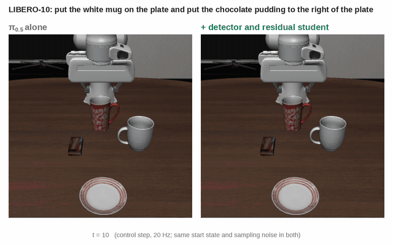</a></p>

### More episodes

Each video replays one evaluated episode three times, side by side: π0.5 alone, replanning at the detected event
(detector only), and replanning plus the residual student. All use held-out start states (25–49) with the same start
state, displacement and sampling noise in every panel. Every replay reproduces the success, length and detector
firings recorded in the result files (`scripts/verify_replays.py`; record in
[assets/videos/replay_check.json](assets/videos/replay_check.json)). The episodes follow fixed rules, not a visual pick:

- **Tasks** (4–6 cm): for each task, the first held-out start state where π0.5 alone and the detector-only replan
  fail and the student succeeds. Tasks 0 and 1 have no such state, and task 6 is Fig. 4.
- **Failure** (4–6 cm): the first (task, start state) where both π0.5 alone and the student fail. Here the
  detector-only replan succeeds, so the residual hurt.
- **Undisturbed**: in task 1, the only task not shown otherwise, the first start state where the detector fires
  falsely and every setting succeeds.
- **8–12 cm**: the first (task, start state) where π0.5 alone and the replan fail and the student succeeds.

These are examples, not rates; for the rates see Table II and Figs. 2–3 of the paper. Click a still to open the MP4
(real time, 20 Hz).

| Episode | What happens | π0.5 alone | Replan only | + Residual student |
|:--|:--|:-:|:-:|:-:|
| [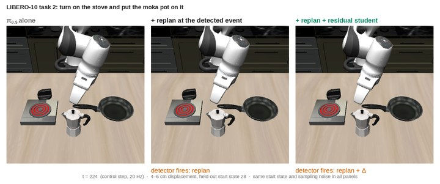](assets/videos/task2_4-6cm_s28.mp4) | Task 2 (turn on the stove and put the moka pot on it), start state 28: the moka pot moves 5.9 cm at t = 130 | timeout | timeout | success |
| [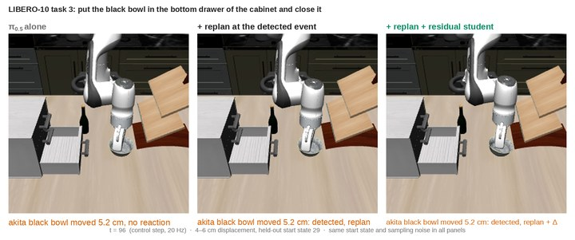](assets/videos/task3_4-6cm_s29.mp4) | Task 3 (black bowl into the bottom drawer, close it), state 29: the bowl moves 5.2 cm at t = 75 | timeout | timeout | success |
| [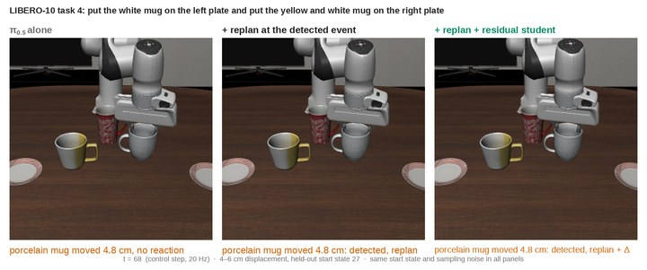](assets/videos/task4_4-6cm_s27.mp4) | Task 4 (two mugs on two plates), state 27: the white mug moves 4.8 cm at t = 47 | timeout | timeout | success |
| [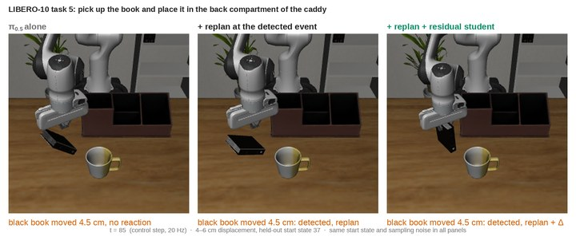](assets/videos/task5_4-6cm_s37.mp4) | Task 5 (book into the caddy's back compartment), state 37: the book moves 4.5 cm at t = 64 | timeout | timeout | success |
| [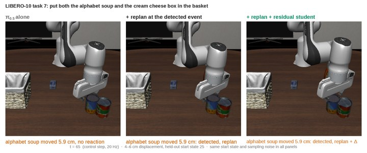](assets/videos/task7_4-6cm_s25.mp4) | Task 7 (alphabet soup and cream cheese into the basket), state 25: the soup moves 5.9 cm at t = 44 | timeout | timeout | success |
| [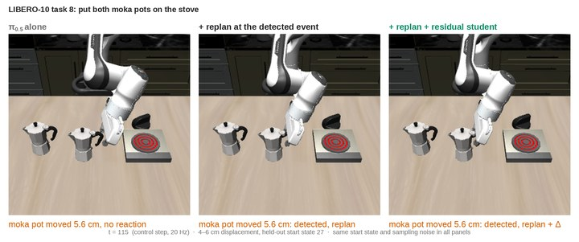](assets/videos/task8_4-6cm_s27.mp4) | Task 8 (both moka pots on the stove), state 27: a moka pot moves 5.6 cm at t = 94 | timeout | timeout | success |
| [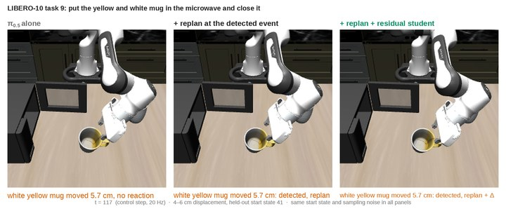](assets/videos/task9_4-6cm_s41.mp4) | Task 9 (mug into the microwave, close it), state 41: the mug moves 5.7 cm at t = 96 | timeout | timeout | success |
| [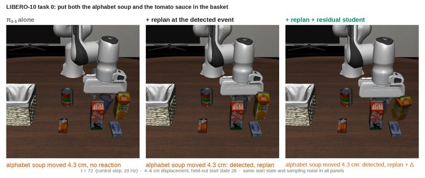](assets/videos/task0_4-6cm_s28.mp4) | **Failure.** Task 0 (alphabet soup and tomato sauce into the basket), state 28: the soup moves 4.3 cm at t = 51 | timeout | success | timeout |
| [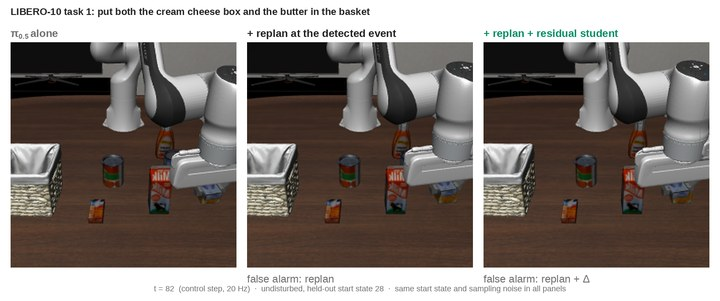](assets/videos/task1_undisturbed_s28.mp4) | **Undisturbed.** Task 1 (cream cheese and butter into the basket), state 28: a false alarm at t = 62 triggers a replan (and the residual) | success | success | success |
| [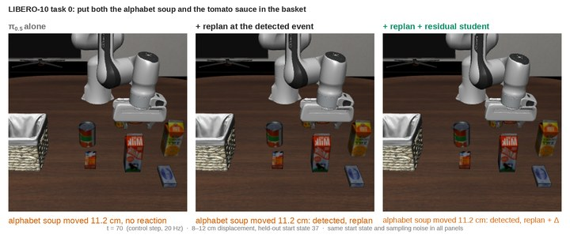](assets/videos/task0_8-12cm_s37.mp4) | **8–12 cm.** Task 0, state 37: the soup moves 11.2 cm at t = 49 | timeout | timeout | success |

## Repository layout

```
experiments/            rollout runner, policy servers, residual RL and distillation (run from this folder)
  bok/                  trained detector and displacement regressor (TorchScript), thresholds, best-of-K files,
                        pre-registration of the extension runs (prereg_ext.md) and its selection records
  ckpt/                 residual teacher (PPO iteration 39), students with and without d̂ (three distillation
                        seeds; seed 0 is the released one), training logs
  results_dist/         per-episode results: base policy, replan schedules, detector
  results_res/          per-episode results: scripted shift, fixed-rule shift, teacher, students
  results_bok/          per-episode results: best-of-8 chunk selection
  results/              undisturbed static (n, h) grid, three runs each
  latency.json          per-query latency of π0.5 measured on an RTX 5090
scripts/                training, analysis and figure scripts, and the run scripts used for the paper
paper_outputs/          numbers, analysis, per-task table and hand-crafted signal AUROCs as used in the paper
paper/                  LaTeX source and preprint PDF of the paper (see paper/README.md)
env.sh                  paths, caches and Python environments (sourced by every run script)
```

The result files are the paper's raw results with the per-step logs (`calls`, `step_change`, `detector_scores`)
removed to keep the repository small; nothing used by the analysis was removed.

## Reproduce the paper's numbers (no GPU or simulator needed)

Requires Python 3 with numpy and matplotlib (tested with Python 3.8, numpy 1.22.4, matplotlib 3.7.5).

```bash
git clone https://github.com/BitAdventurer/VLA-Disturbance-Recovery.git && cd VLA-Disturbance-Recovery
export VLA_EXPERIMENTS=$PWD/experiments
mkdir -p out/figures out/tables
python scripts/fig_paper.py out/figures      # res_forest.pdf, res_general.pdf, res_numbers.json
python scripts/table_pertask.py out          # tables/res_pertask.tex, figures/res_analysis.json
diff out/figures/res_numbers.json paper_outputs/res_numbers.json
diff out/figures/res_analysis.json paper_outputs/res_analysis.json
diff out/tables/res_pertask.tex paper_outputs/res_pertask.tex
python scripts/diag_grasp.py                 # Table I: success and failure columns (100 tracked episodes)
```

`scripts/compare_res.py` and `scripts/analyze_res.py` give paired comparisons between any two arms, for example
`python scripts/compare_res.py student_v2,student_v2_ns1 --ref obj_static_n2_h10_s0,obj_static_n2_h10_ns1_s0`.

## Run the experiments

Tested on Linux with one NVIDIA RTX 5090 and [uv](https://docs.astral.sh/uv/). π0.5 runs through openpi's
PyTorch path; LIBERO runs in a separate Python 3.8 client environment.

**Setup.** `VLA_ENV` holds openpi, the Python environments, the checkpoint and all caches.

```bash
export VLA_ENV=/path/to/workdir VLA_SCRIPTS=$PWD/scripts VLA_EXPERIMENTS=$PWD/experiments
git clone --recurse-submodules https://github.com/Physical-Intelligence/openpi.git $VLA_ENV/openpi
git -C $VLA_ENV/openpi checkout 215abfb217dbac7d5f1273282331b9b1866c0479
git -C $VLA_ENV/openpi submodule update --init --recursive
cp env.sh $VLA_ENV/env.sh && source $VLA_ENV/env.sh
bash scripts/setup_openpi.sh             # openpi environment, torch 2.7.1 (CUDA 12.8)
bash scripts/setup_libero.sh             # LIBERO client environment (Python 3.8, CPU torch)
bash scripts/download_ckpt.sh pi05_libero
bash scripts/convert_ckpt.sh             # JAX checkpoint -> PyTorch
```

LIBERO reads its paths from `$LIBERO_CONFIG_PATH/config.yaml`; point `benchmark_root`, `bddl_files`,
`init_states` and `assets` to `$VLA_ENV/openpi/third_party/libero/libero/libero`.

**Policy servers.** Two π0.5 servers on ports 8000 and 8001 (both fit on one 32 GB GPU):

```bash
bash scripts/start_servers.sh 8000 8001
```

All commands below run from `experiments/` after `source $VLA_ENV/env.sh`.

**Base policy and detector replanning** under the disturbance (one noise draw; add `--noise_salt k` for more):

```bash
OBJ="--latency latency.json --schedule static --n 2 --h 10 --disturb object --disturb_trigger approach --disturb_mag 0.04,0.06 --seed 0"
$LIBERO_PY run_libero.py --port 8000 $OBJ --out results_dist/obj_static_n2_h10_s0.jsonl
DET="--schedule react_step --detector bok/detector_v1_t24.pt --step_tau 1.628 --react_setting 2,10"
$LIBERO_PY run_libero.py --port 8000 $OBJ $DET --out results_dist/det_n2h10_s0.jsonl
```

**Evaluate the released modules** (all 500 episodes; drop the two `--eval_init_*` flags for the held-out half):

```bash
P="--ports 8000,8001 --workers_per_port 5 --eval_init_lo 0 --eval_init_hi 50"
# residual student
$LIBERO_PY residual_rl.py $P --eval student:ckpt/student_v2.pt --dispreg bok/dispreg_v2_t24.pt $DET --gate jump \
    --eval_out results_res/student_v2.jsonl
# fixed-rule shift 0.5 d̂
$LIBERO_PY residual_rl.py $P --eval vision:0.5,2 --dispreg bok/dispreg_v2_t24.pt $DET --eval_out results_res/vision_s05_k2.jsonl
# privileged teacher (held-out initial states)
$LIBERO_PY residual_rl.py --ports 8000,8001 --workers_per_port 5 --eval ckpt/res_v4.pt.it039 --gate jump \
    --eval_out results_res/eval_res_v4_it039.jsonl
```

Add `--eval_disturb none` for undisturbed episodes, `--disturb_mag 0.08,0.12` for twice-as-large displacements,
and `--eval_noise_salt k` for further noise draws.

**Table I tracking runs** (the base policy with every executed step logged, initial states 0–9):

```bash
$LIBERO_PY run_libero.py --port 8000 $OBJ --log_exec 1 --tasks 0,1,2,3 --trials 10 --out results_res/diag_a.jsonl
$LIBERO_PY run_libero.py --port 8001 $OBJ --log_exec 1 --tasks 4,5,6 --trials 10 --out results_res/diag_b.jsonl
$LIBERO_PY run_libero.py --port 8000 $OBJ --log_exec 1 --tasks 7,8,9 --trials 10 --out results_res/diag_c.jsonl
```

**Pre-registered fresh-state test** (initial states 50–99 of each task's full `.init` file, `--init_file full`;
arms, noise salts and the completeness check as in `experiments/bok/run_fresh50.sh` and `prereg_fresh50.md`):

```bash
F="--ports 8000,8001 --workers_per_port 5 --init_file full --eval_init_lo 50 --eval_init_hi 100"
$LIBERO_PY residual_rl.py $F --eval zero --eval_noise_salt 0 --eval_out results_test/fresh_base_s0.jsonl
$LIBERO_PY residual_rl.py $F --eval student:ckpt/student_v2.pt --dispreg bok/dispreg_v2_t24.pt $DET --gate jump \
    --eval_noise_salt 0 --eval_out results_test/fresh_student_s0.jsonl
$LIBERO_PY residual_rl.py $F --eval vision:0.5,2 --dispreg bok/dispreg_v2_t24.pt $DET --eval_noise_salt 0 \
    --eval_out results_test/fresh_fixed_s0.jsonl
```

**Train the modules.**

```bash
# 1. detector: per-step frames of disturbed and undisturbed runs, train on initial states 0-24
$LIBERO_PY run_libero.py --port 8000 $OBJ --log_frames results_bok/frames/obj_s0 --out results_bok/frames_obj_s0.jsonl
$LIBERO_PY run_libero.py --port 8001 $OBJ --noise_salt 1 --log_frames results_bok/frames/obj_ns1 --out results_bok/frames_obj_ns1.jsonl
$LIBERO_PY run_libero.py --port 8000 --latency latency.json --schedule static --n 2 --h 10 --seed 0 \
    --log_frames results_bok/frames/none_s0 --out results_bok/frames_none_s0.jsonl
$OPENPI_PY $VLA_SCRIPTS/train_detector.py --out bok/detector_v1.pt
$LIBERO_PY $VLA_SCRIPTS/train_detector.py export bok/detector_v1.pt.state.pt bok/detector_v1_t24.pt
# 2. displacement regressor: event frames, 2-10 cm, six disturbance seeds
bash $VLA_SCRIPTS/run_dispdata.sh
$OPENPI_PY $VLA_SCRIPTS/train_dispreg2.py --out bok/dispreg_v2.pt
$LIBERO_PY $VLA_SCRIPTS/train_dispreg2.py export bok/dispreg_v2.pt.state.pt bok/dispreg_v2_t24.pt
# 3. privileged teacher: behavior cloning from the scripted shift 0.5 d, then 40 PPO iterations
$LIBERO_PY residual_rl.py --out ckpt/res_v4.pt --ports 8000,8001 --workers_per_port 6 --gate jump --iters 40 \
    --episodes 120 --batch_episodes 6 --critic_warmup 1 --bc_script 0.5,2 --bc_episodes 500 --save_every 10
# 4. vision-only student: DAgger with beta = 1, 0.5, 0 (--no_dhat: ablation without d̂; --seed S: another
#    distillation seed, 0 = the released student)
$LIBERO_PY student_distill.py --teacher ckpt/res_v4.pt.it039 --dispreg bok/dispreg_v2_t24.pt $DET --gate jump \
    --ports 8000,8001 --workers_per_port 6 --reps 2 --out ckpt/student_v2.pt
```

The `scripts/run_*.sh` files are the run records behind most results; the detector-replan, oracle-timing, undisturbed
and sliding baselines were started by hand with the commands above (`--schedule react_now` / `react_next`,
`--disturb none`, `--disturb drift`). The scripts wait on one another through log markers (for example,
`run_chain3_teacher4.sh` waits for `CHAIN2_COMPLETE`), so copy the commands you need instead of running them
unchanged. Where each result comes from:

| Result | Script |
|---|---|
| Base policy, replan frequency, integration steps, oracle replan timing | `run_dist_probe.sh`, `run_dist_more.sh`, `run_reseed.sh`, `run_chain6_draws.sh` |
| Best-of-8 chunk selection (preregistered in `experiments/bok/prereg_bok.md`) | `run_signal.sh` |
| Displacement regressor, fixed-rule shift | `run_dispdata.sh`, `run_chain_vision.sh` |
| Teacher, student, undisturbed episodes | `run_chain3_teacher4.sh` |
| Larger and other disturbances, ablations, extra draws | `run_chain4_general.sh`, `run_chain5_nodhat_big.sh`, `run_chain6_draws.sh` |
| Detector replan with the scripted shift (three draws), teacher with the detector replan (Sec. V-C) | `run_chain7_reviewcheck.sh` |
| Scripted shift and its α sweep | `run_probe.sh` |
| Table II on all 500 episodes, longer fixed-rule windows, extra draws, distillation seeds, openpi's (10, 5) (pre-registered in `experiments/bok/prereg_ext.md`) | `run_chain8_extension.sh`, `run_chain8b_b6.sh`, `run_chain8c_b2s2.sh` |
| Failure tracking (Table I) | the tracking runs above (`--log_exec 1`), `diag_grasp.py` |
| Pre-registered fresh-state test (initial states 50–99) | `experiments/bok/run_fresh50.sh`, analysis block in `fig_paper.py` |
| Qualitative episode (Fig. 4) | `qual_frames.py`, `fig_qual.py`; video: `video_frames.py`, `compose_video.py` |
| More episode videos (README) | `run_videos.sh` (`video_frames.py`, `verify_replays.py`, `compose_episode.py`) |

## Citation

```bibtex
@inproceedings{ji2027replan,
  author    = {Ji, Chang-Hoon and Kam, Tae-Eui},
  title     = {When to Replan and How Much to Correct: Residual Reinforcement Learning for Disturbance Recovery in Vision-Language-Action Policies},
  booktitle = {Proc. Int. Conf. Electronics, Information, and Communication (ICEIC)},
  year      = {2027}
}
```

## License

Code is released under the MIT License. The paper (the files in `paper/` and the copies of its figures in
`assets/`) is not covered by it; see [paper/README.md](paper/README.md). π0.5 and openpi are subject to their own licenses
([openpi](https://github.com/Physical-Intelligence/openpi)); LIBERO is subject to its license
([LIBERO](https://github.com/Lifelong-Robot-Learning/LIBERO)).
