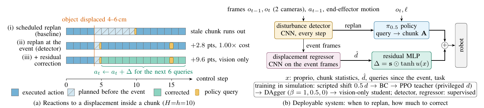
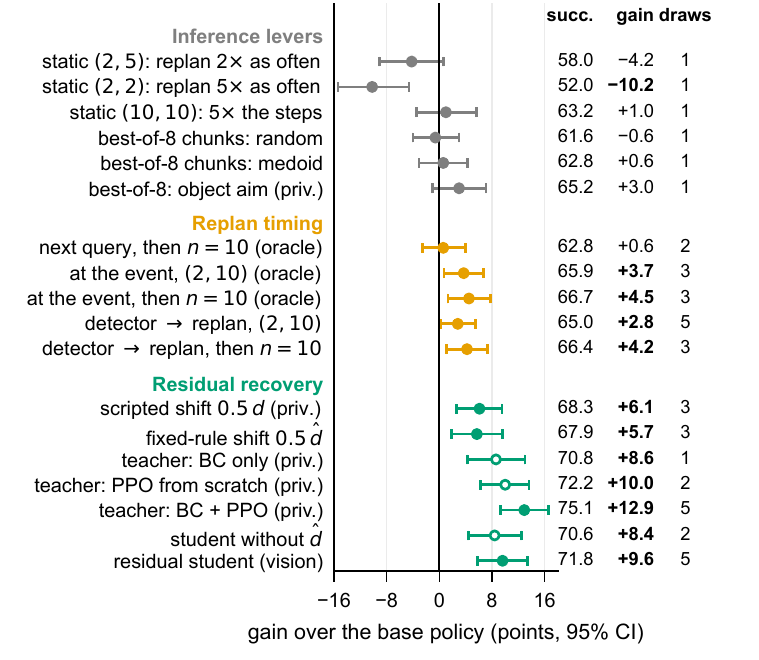
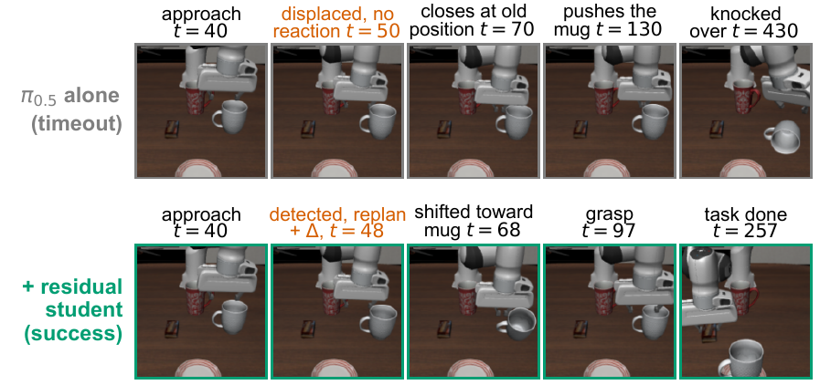

# When to Replan and How Much to Correct

Code, trained modules and per-episode results for our paper submitted to ICEIC 2027

> **When to Replan and How Much to Correct: Residual Reinforcement Learning for Disturbance Recovery in Vision-Language-Action Policies**<br>
> Chang-Hoon Ji and Tae-Eui Kam, Korea University



A chunked vision-language-action policy executes several actions per query open loop. When an object is displaced
while the gripper approaches it, the robot keeps following a plan made for the old scene: on LIBERO-10, a 4–6 cm
displacement cuts the success rate of π0.5 from 95% to 65%. This repository adds three small learned modules around
the policy, whose weights are not updated:

- a **disturbance detector** (CNN on consecutive camera frames and the executed action) that decides *when to
  replan*, interrupting the current chunk at the event;
- a **displacement regressor** that estimates how far the object moved from the frames around the event;
- an **event-gated residual** Δ = s ⊙ tanh u(x) that decides *how much to correct*, added to every action for the
  six queries after the event.

The residual is trained in simulation as a privileged teacher (behavior cloning from a scripted shift, then PPO)
and distilled with DAgger into a student that uses only proprioception, the predicted chunk and the regressor's
estimate.

## Results

π0.5 on LIBERO-10, 4–6 cm object displacement on approach, (n, h) = (2, 10). All 500 disturbed episodes
(10 tasks × 50 initial states; half of them use the initial states the modules were trained on). Gains are paired
against the seven-draw mean of the base policy on the same episodes, with task-stratified bootstrap 95% intervals.

| Method | Input | Draws | Success (%) | Gain [95% interval] | Undisturbed (%) |
|---|:-:|:-:|:-:|:-:|:-:|
| π0.5 alone | – | 7 | 64.7 | – | 95.4 |
| Detector → replan | V | 5 | 67.2 | +2.5 [+0.6, +4.5] | 95.2 |
| Detector → replan, then n = 10 | V | 3 | 67.9 | +3.3 [+1.1, +5.5] | – |
| Scripted shift 0.5 d | P | 1 | 72.2 | +7.5 [+4.2, +10.9] | 95.2* |
| Fixed-rule shift 0.5 d̂ | V | 3 | 71.2 | +6.5 [+3.7, +9.4] | 95.4 |
| Residual teacher (BC + PPO)* | P | 5 | 75.1 | +12.9 [+9.3, +16.6] | 94.8 |
| Student without d̂ | V | 2 | 74.5 | +9.8 [+7.0, +12.7] | 95.4 |
| **Residual student** | V | 5 | **75.9** | **+11.2 [+8.5, +14.0]** | 95.4 |

V: camera frames and proprioception; P: privileged simulator state. *Held-out initial states only
(250 episodes; base 62.2%, undisturbed 95.2%). On the 250 held-out episodes the student reaches 71.8%
(+9.6 [+5.8, +13.4]); on displacements twice as large (8–12 cm) it gains +6.5 points.

<p align="center"></p>

Inference-time levers (replanning more often, more integration steps, best-of-8 chunk selection) recover little or
none of the loss; replanning helps only when timed at the event; the learned residual gains the most. Every number
above and in the paper is recomputed from the result files in this repository (see below).

<p align="center"></p>

## Repository layout

```
experiments/            rollout runner, policy servers, residual RL and distillation (run from this folder)
  bok/                  trained detector and displacement regressor (TorchScript), thresholds, best-of-K files
  ckpt/                 residual teacher (PPO iteration 39), students with and without d̂, training logs
  results_dist/         per-episode results: base policy, replan schedules, detector
  results_res/          per-episode results: scripted shift, fixed-rule shift, teacher, students
  results_bok/          per-episode results: best-of-8 chunk selection
  latency.json          per-query latency of π0.5 measured on an RTX 5090
scripts/                training, analysis and figure scripts, and the run scripts used for the paper
paper_outputs/          numbers, analysis and per-task table exactly as used in the paper
env.sh                  paths, caches and Python environments (sourced by every run script)
```

The result files are the paper's raw results with the per-step logs (`calls`, `step_change`, `detector_scores`)
removed to keep the repository small; nothing used by the analysis was removed.

## Reproduce the paper's numbers (no GPU or simulator needed)

Requires Python 3 with numpy and matplotlib (tested with Python 3.8, numpy 1.22.4, matplotlib 3.7.5).

```bash
git clone https://github.com/BitAdventurer/VLA-Disturbance-Recovery.git && cd VLA-Disturbance-Recovery
export VLA_EXPERIMENTS=$PWD/experiments
mkdir -p out/figures out/tables
python scripts/fig_paper.py out/figures      # res_forest.pdf, res_general.pdf, res_numbers.json
python scripts/table_pertask.py out          # tables/res_pertask.tex, figures/res_analysis.json
diff out/figures/res_numbers.json paper_outputs/res_numbers.json
diff out/figures/res_analysis.json paper_outputs/res_analysis.json
diff out/tables/res_pertask.tex paper_outputs/res_pertask.tex
```

`scripts/compare_res.py` and `scripts/analyze_res.py` give paired comparisons between any two arms, for example
`python scripts/compare_res.py student_v2,student_v2_ns1 --ref obj_static_n2_h10_s0,obj_static_n2_h10_ns1_s0`.

## Run the experiments

Tested on Linux with one NVIDIA RTX 5090 and [uv](https://docs.astral.sh/uv/). π0.5 runs through openpi's
PyTorch path; LIBERO runs in a separate Python 3.8 client environment.

**Setup.** `VLA_ENV` holds openpi, the Python environments, the checkpoint and all caches.

```bash
export VLA_ENV=/path/to/workdir VLA_SCRIPTS=$PWD/scripts VLA_EXPERIMENTS=$PWD/experiments
git clone --recurse-submodules https://github.com/Physical-Intelligence/openpi.git $VLA_ENV/openpi
git -C $VLA_ENV/openpi checkout 215abfb217dbac7d5f1273282331b9b1866c0479
git -C $VLA_ENV/openpi submodule update --init --recursive
cp env.sh $VLA_ENV/env.sh && source $VLA_ENV/env.sh
bash scripts/setup_openpi.sh             # openpi environment, torch 2.7.1 (CUDA 12.8)
bash scripts/setup_libero.sh             # LIBERO client environment (Python 3.8, CPU torch)
bash scripts/download_ckpt.sh pi05_libero
bash scripts/convert_ckpt.sh             # JAX checkpoint -> PyTorch
```

LIBERO reads its paths from `$LIBERO_CONFIG_PATH/config.yaml`; point `benchmark_root`, `bddl_files`,
`init_states` and `assets` to `$VLA_ENV/openpi/third_party/libero/libero/libero`.

**Policy servers.** Two π0.5 servers on ports 8000 and 8001 (both fit on one 32 GB GPU):

```bash
bash scripts/start_servers.sh 8000 8001
```

All commands below run from `experiments/` after `source $VLA_ENV/env.sh`.

**Base policy and detector replanning** under the disturbance (one noise draw; add `--noise_salt k` for more):

```bash
OBJ="--latency latency.json --schedule static --n 2 --h 10 --disturb object --disturb_trigger approach --disturb_mag 0.04,0.06 --seed 0"
$LIBERO_PY run_libero.py --port 8000 $OBJ --out results_dist/obj_static_n2_h10_s0.jsonl
DET="--schedule react_step --detector bok/detector_v1_t24.pt --step_tau 1.628 --react_setting 2,10"
$LIBERO_PY run_libero.py --port 8000 $OBJ $DET --out results_dist/det_n2h10_s0.jsonl
```

**Evaluate the released modules** (all 500 episodes; drop the two `--eval_init_*` flags for the held-out half):

```bash
P="--ports 8000,8001 --workers_per_port 5 --eval_init_lo 0 --eval_init_hi 50"
# residual student
$LIBERO_PY residual_rl.py $P --eval student:ckpt/student_v2.pt --dispreg bok/dispreg_v2_t24.pt $DET --gate jump \
    --eval_out results_res/student_v2.jsonl
# fixed-rule shift 0.5 d̂
$LIBERO_PY residual_rl.py $P --eval vision:0.5,2 --dispreg bok/dispreg_v2_t24.pt $DET --eval_out results_res/vision_s05_k2.jsonl
# privileged teacher (held-out initial states)
$LIBERO_PY residual_rl.py --ports 8000,8001 --workers_per_port 5 --eval ckpt/res_v4.pt.it039 --gate jump \
    --eval_out results_res/eval_res_v4_it039.jsonl
```

Add `--eval_disturb none` for undisturbed episodes, `--disturb_mag 0.08,0.12` for twice-as-large displacements,
and `--eval_noise_salt k` for further noise draws.

**Train the modules.**

```bash
# 1. detector: per-step frames of disturbed and undisturbed runs, train on initial states 0-24
$LIBERO_PY run_libero.py --port 8000 $OBJ --log_frames results_bok/frames/obj_s0 --out results_bok/frames_obj_s0.jsonl
$LIBERO_PY run_libero.py --port 8001 $OBJ --noise_salt 1 --log_frames results_bok/frames/obj_ns1 --out results_bok/frames_obj_ns1.jsonl
$LIBERO_PY run_libero.py --port 8000 --latency latency.json --schedule static --n 2 --h 10 --seed 0 \
    --log_frames results_bok/frames/none_s0 --out results_bok/frames_none_s0.jsonl
$OPENPI_PY $VLA_SCRIPTS/train_detector.py --out bok/detector_v1.pt
$LIBERO_PY $VLA_SCRIPTS/train_detector.py export bok/detector_v1.pt.state.pt bok/detector_v1_t24.pt
# 2. displacement regressor: event frames, 2-10 cm, six disturbance seeds
bash $VLA_SCRIPTS/run_dispdata.sh
$OPENPI_PY $VLA_SCRIPTS/train_dispreg2.py --out bok/dispreg_v2.pt
$LIBERO_PY $VLA_SCRIPTS/train_dispreg2.py export bok/dispreg_v2.pt.state.pt bok/dispreg_v2_t24.pt
# 3. privileged teacher: behavior cloning from the scripted shift 0.5 d, then 40 PPO iterations
$LIBERO_PY residual_rl.py --out ckpt/res_v4.pt --ports 8000,8001 --workers_per_port 6 --gate jump --iters 40 \
    --episodes 120 --batch_episodes 6 --critic_warmup 1 --bc_script 0.5,2 --bc_episodes 500 --save_every 10
# 4. vision-only student: DAgger with beta = 1, 0.5, 0 (add --no_dhat for the ablation without d̂)
$LIBERO_PY student_distill.py --teacher ckpt/res_v4.pt.it039 --dispreg bok/dispreg_v2_t24.pt $DET --gate jump \
    --ports 8000,8001 --workers_per_port 6 --reps 2 --out ckpt/student_v2.pt
```

The `scripts/run_*.sh` files are the exact run records behind the paper. They wait on one another through log
markers (for example, `run_chain3_teacher4.sh` waits for `CHAIN2_COMPLETE`), so copy the commands you need instead
of running them unchanged. Where each result comes from:

| Result | Script |
|---|---|
| Base policy, replan frequency, integration steps, oracle replan timing | `run_dist_probe.sh`, `run_dist_more.sh`, `run_reseed.sh`, `run_chain6_draws.sh` |
| Best-of-8 chunk selection (preregistered in `experiments/bok/prereg_bok.md`) | `run_signal.sh` |
| Displacement regressor, fixed-rule shift | `run_dispdata.sh`, `run_chain_vision.sh` |
| Teacher, student, undisturbed episodes | `run_chain3_teacher4.sh` |
| Larger and other disturbances, ablations, extra draws | `run_chain4_general.sh`, `run_chain5_nodhat_big.sh`, `run_chain6_draws.sh` |
| Qualitative episode (Fig. 4) | `qual_frames.py`, `fig_qual.py` |

## Citation

```bibtex
@inproceedings{ji2027replan,
  author    = {Ji, Chang-Hoon and Kam, Tae-Eui},
  title     = {When to Replan and How Much to Correct: Residual Reinforcement Learning for Disturbance Recovery in Vision-Language-Action Policies},
  booktitle = {Proc. Int. Conf. Electronics, Information, and Communication (ICEIC)},
  year      = {2027}
}
```

## License

Code is released under the MIT License. π0.5 and openpi are subject to their own licenses
([openpi](https://github.com/Physical-Intelligence/openpi)); LIBERO is subject to its license
([LIBERO](https://github.com/Lifelong-Robot-Learning/LIBERO)).
